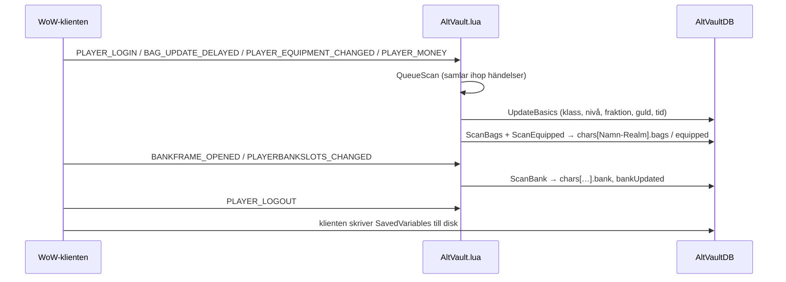
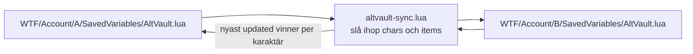

# LLD – AltVault

> Hur addonen är byggd, så att den kan ändras säkert. Uppdateras i samma PR som koden (Claude-skill: `lld-update`).
> Beskriver version 1.0.0 på `main`. Version 1.1.0 (post, minimapknapp, reagenspanel) ligger i [PR 1](https://github.com/JoseMdS/altvault/pull/1); se avsnitt 7.

## 1. Syfte och avgränsning
AltVault sparar vad varje karaktär har (väskor, bank, utrustning, guld) och gör det sökbart från alla karaktärer, även över två konton med synkskriptet. Addonen läser bara spelets egna API:er. Den flyttar inga föremål och pratar inte med någon server.

## 2. Komponenter och filer

| Del | Fil | Ansvar |
|---|---|---|
| Addon | `AltVault.toc` | Interface 16001 (WoW Forever), `SavedVariables: AltVaultDB` |
| Kärna och UI | `AltVault.lua` | Kompatibilitetshjälpare (`C_Container` eller gamla API:t), skanning, sökning, tooltip-krokar, fönster, slash-kommandon, händelser |
| Synk | `sync/altvault-sync.lua` | Slår ihop `AltVaultDB` från alla konton i en WoW-installation |
| Synk (Mac) | `sync/Sync AltVault.command` | Dubbelklickbar start av synkskriptet |

## 3. Flöden

### Skanning i spelet


### Synk mellan konton (spelet stängt)

Skriptet vägrar köra om WoW är igång, eftersom klienten skriver över SavedVariables vid utloggning. Vilket konto som äger en karaktär läses från mappstrukturen `WTF/Account/<konto>/<server>/<Namn-Realm>`.

## 4. Gränssnitt
| Kommando | Gör |
|---|---|
| `/vault` (`/altvault`) | Öppnar eller stänger fönstret med alla karaktärer och guld |
| `/vault <text>` | Söker föremål i alla karaktärers väskor, bank och utrustning |
| `/vault delete Namn-Realm` | Tar bort en karaktär |
| `/vault help` | Hjälp |
| Tooltip | Rader med antal per karaktär (väskor, bank) under varje föremål |

`lua sync/altvault-sync.lua "<WoW-install>/_forever_"` kör synken.

## 5. Data
`AltVaultDB` (SavedVariables per konto):

```lua
AltVaultDB = {
  version = 1,
  items = { [itemId] = itemLink },          -- för namn och sökning
  chars = {
    ["Namn-Realm"] = {
      class, level, faction, money, updated, -- grunddata
      bags = { [itemId] = antal },
      equipped = { [itemId] = antal },
      bank = { [itemId] = antal }, bankUpdated,
      account,                               -- sätts av synkskriptet
    },
  },
}
```

## 6. Test och kvalitet
- Manuellt i spelet och med en fejkad WoW-miljö under Lua 5.1 (rökprov av skanning, sökning och kommandon).
- Synkskriptet provat med Lua 5.4 på två fejkade konton.
- CI: `docs.yml` kontrollerar dokumentationen. Lua-tester i CI finns inte ännu.

## 7. Kända begränsningar och pågående arbete
- Version 1.1.0 i PR 1 lägger till postlådan ([AV-KRAV-002](https://github.com/JoseMdS/altvault/issues/4)), egna inställningar per konto vid synk ([AV-KRAV-006](https://github.com/JoseMdS/altvault/issues/10)), reagenspanel ([AV-KRAV-008](https://github.com/JoseMdS/altvault/issues/14)) och minimapknapp ([AV-KRAV-009](https://github.com/JoseMdS/altvault/issues/16)). Den är inte provad i spelet ([AV-KRAV-010](https://github.com/JoseMdS/altvault/issues/17)). Uppdatera den här LLD:n när PR 1 slås ihop (`Mail.lua`, `Minimap.lua`, `Crafting.lua`, `chars[…].mail`, inställningar per konto).
- Synken kräver Lua och har bara ett Mac-skript ([AV-KRAV-007](https://github.com/JoseMdS/altvault/issues/11)).
- Banken syns först när karaktären har besökt en bank.

## 8. Spårbarhet
| Krav | Var i koden | Test |
|---|---|---|
| [AV-KRAV-001](https://github.com/JoseMdS/altvault/issues/3) Väskor, bank, utrustning, guld | `AltVault.lua`: `UpdateBasics`, `ScanBags`, `ScanEquipped`, `ScanBank` | rökprov |
| [AV-KRAV-003](https://github.com/JoseMdS/altvault/issues/6) /vault och sökning | `AltVault.lua`: `Search`, `ShowSearch`, `ShowCharacters`, `SlashCmdList.ALTVAULT` | rökprov |
| [AV-KRAV-004](https://github.com/JoseMdS/altvault/issues/7) Antal i tooltips | `AltVault.lua`: `WhoHas`, `AddTooltipLines`, `HookTooltips` | rökprov |
| [AV-KRAV-005](https://github.com/JoseMdS/altvault/issues/9) Synk mellan konton | `sync/altvault-sync.lua` | två fejkade konton |
